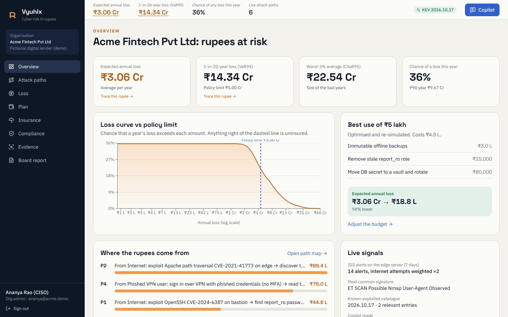
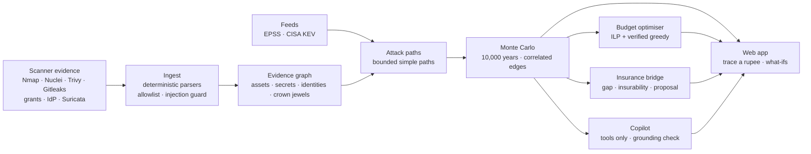

<div align="center">

# Vyuhix

### Every way in. Priced in rupees.

**Vyuhix turns security-scanner evidence into attack paths, a simulated annual loss in ₹, the best fixes for a fixed budget, and an insurance view. Every rupee can be traced back to the evidence that produced it.**

`Python 3.12` · `FastAPI` · `NumPy Monte Carlo` · `NetworkX` · `PuLP + HiGHS` · `React 19` · `React Flow` · `Recharts` · `Tailwind v4`



[Watch the full walkthrough (MP4)](app_screenshots_screen_recording/vyuhix_full_walkthrough.mp4) · [All screenshots](app_screenshots_screen_recording/README.md) · [Docs](docs/README.md) · [Research](research/README.md) · [Build prompt](COPILOT_PROMPT.md)

</div>

---

## The name

A **vyuha** (व्यूह) is a battle formation in classical Indian strategy. The best known is the *Chakravyuha*, a spiral maze an attacker had to fight through layer by layer. An organisation's network is the same kind of maze, seen from the other side. Vyuhix maps every route through it, works out what each route would cost if an attacker walked it, and shows which walls to build first.

## The problem, in four sentences

Boards still hear cyber risk as "High / Medium / Low", and nobody can approve a budget against a colour. Security teams hold thousands of findings sorted by CVSS, which says how bad a bug *could* be, not how likely it is to be used or what it would cost. Insurers price cyber policies from self-declared questionnaires disconnected from live evidence. India's stakes are rising: IBM's 2025 study put the average Indian breach at **₹22 crore**, and the DPDP Act allows penalties of up to **₹250 crore**.

## What Vyuhix does

| | Capability | What you see |
|---|---|---|
| 1 | **Evidence in** | Nmap, Nuclei, Trivy, Gitleaks, Postgres grants, identity exports and Suricata IDS alerts parsed into one evidence model. Scans are refused outside authorised ranges. Instruction-like text in scanner output is quarantined |
| 2 | **Attack paths** | A graph of assets, secrets, identities and crown jewels; every route from an entry point to sensitive data, explained in plain English |
| 3 | **Loss in rupees** | 10,000 simulated years (FAIR-style Monte Carlo). Edges are sampled, so overlapping paths are correlated. Outputs: expected annual loss, 1-in-20-year loss (VaR95), CVaR95 and the loss-exceedance curve |
| 4 | **Trace a rupee** | Click any figure to see the paths, edges, scanner evidence, EPSS and KEV values, and assumptions behind it |
| 5 | **Budget plan** | "We have ₹5 lakh. What do we buy?" An integer program and a simulation-verified search each propose a plan; re-simulation picks the winner. Includes the investment-vs-risk frontier |
| 6 | **Insurance bridge** | Insurability score from evidence-weighted controls, coverage gap against the policy limit (drag the limit on the curve), proposal answers linked to evidence, claims readiness. Never a premium quote |
| 7 | **Copilot** | Answers questions by calling engine tools. A grounding check blocks any figure no tool produced. Works offline; uses Claude when an API key is set |
| 8 | **Drift** | A new known-exploited CVE re-prices risk and raises an alert with its cause |
| 9 | **Roles and audit** | CISO, analyst, board viewer, broker (consented, insurance view only) and platform admin; a hash-chained, append-only audit log |

## Results on the demo organisation

*Acme Fintech Pvt Ltd* is a **fictional** digital lender with ₹180 Cr revenue, two lakh borrowers and a ₹5 Cr cyber policy. All its data is synthetic.

| Measure | Value |
|---|---|
| Expected annual loss | **₹3.06 Cr** |
| 1-in-20-year loss (VaR95) | **₹14.34 Cr**: the ₹5 Cr policy leaves a **₹9.34 Cr** gap |
| Chance of any loss in a year | 36% |
| Largest path | Internet → Apache 2.4.49 (CVE-2021-41773, KEV) → `.env` secret → `app_admin` → `customers`: **₹89.4 L a year** |
| Best use of ₹5 lakh | 3 controls costing ₹4.0 L cut expected loss to **₹18.8 L (−94%)** |
| "What if we enforce MFA?" | ₹3.06 Cr → ₹2.12 Cr (−31%) |
| Simulated KEV update (OpenSSH CVE added) | EAL **+₹1.18 Cr (+39%)**, alert raised with the cause |
| Simulation time | ~10 ms per run of 10,000 years (cached runs are instant) |
| Backend tests | **38 passing**: invariants, optimiser vs brute force, guardrails, roles, audit tampering |

These are **model outputs under labelled demo assumptions**, not claims about any real company.

## Quick start

**Needs:** Python 3.11+ and Node.js 20+. Docker, a GPU and cloud accounts are not required.

```bash
git clone https://github.com/Gurjas2112/Vyuhix.git && cd Vyuhix

# 1 · backend
python -m venv .venv && source .venv/bin/activate          # Windows: .venv\Scripts\activate
pip install -r backend/requirements.txt

# 2 · frontend (builds into frontend/dist, served by the API)
cd frontend && npm install && npm run build && cd ..

# 3 · run
cd backend && uvicorn vyuhix.main:app --port 8000
```

Open **http://localhost:8000**, click a demo account (password `Demo@12345`), and follow the [demo script](docs/07_demo_script.md).

| Account | Role | Sees |
|---|---|---|
| `ananya@acme.demo` | Org admin (CISO) | Everything for Acme, can scan |
| `rohit@acme.demo` | Viewer (CFO/board) | Dashboards, plan, report, copilot |
| `karan@broker.demo` | Broker | Loss quantiles and insurance view only |
| `divya@platform.demo` | Platform admin | Admin console: feeds, guardrails, audit, users |

**Development mode** (hot reload): run the API as above and `cd frontend && npm run dev`, then open http://localhost:5173. Vite proxies `/api` to port 8000.

**Optional: Claude copilot.** `export ANTHROPIC_API_KEY=...` before starting the API. Without it the copilot runs a deterministic offline router with the same tools and the same grounding check.

One-command scripts: [`scripts/run_demo.sh`](scripts/run_demo.sh) (macOS/Linux/Git Bash) and [`scripts/run_demo.ps1`](scripts/run_demo.ps1) (PowerShell).

## How it works



The full explanation is in [docs/02_how_it_works.md](docs/02_how_it_works.md), and the maths in plain words is in [docs/04_the_risk_model_in_plain_words.md](docs/04_the_risk_model_in_plain_words.md).

### Three rules the design never breaks

1. **The AI never produces a number.** Rupees, probabilities and percentages come from deterministic code. Any copilot answer with an untraceable figure is blocked and logged.
2. **Every figure is traceable.** Same evidence + same seed = same numbers, and every number opens its provenance.
3. **Only authorised targets are scanned.** The allowlist is enforced in code before anything is sent, and refusals are audited.

## Repository map

```
Vyuhix/
├── README.md                         ← you are here
├── backend/                          ← FastAPI + engine (Python)
│   ├── vyuhix/                       model · montecarlo · engine · optimise · insurance · compliance
│   │                                 ingest · copilot · auth · store · feeds · main (API)
│   └── tests/                        38 tests
├── frontend/                         ← React 19 + Vite + Tailwind v4
│   └── src/pages/                    Login · Overview · Paths · Loss · Plan · Insurance · Compliance
│                                     Evidence · Report · Admin
├── data/demo/acme-fintech/           ← synthetic org, evidence in real tool formats, feed snapshots
├── docs/                             ← plain-language docs (start at docs/README.md)
├── research/                         ← research notes and references behind the design
├── app_screenshots_screen_recording/ ← 22 flow screenshots + full walkthrough video
└── scripts/                          ← run_demo.sh · run_demo.ps1 · capture_walkthrough.py
```

## Testing

```bash
cd backend && python -m pytest -q        # 38 passed
cd frontend && npx tsc -b                # type-check
python scripts/capture_walkthrough.py    # regenerates every screenshot and the video (app must be running)
```

What the tests prove is listed in [docs/09_testing.md](docs/09_testing.md).

## Documentation

| Doc | For |
|---|---|
| [What is Vyuhix?](docs/01_what_is_vyuhix.md) | Anyone. Five-minute read |
| [How it works](docs/02_how_it_works.md) | The pipeline, step by step |
| [Architecture](docs/03_architecture.md) | Engineers |
| [The risk model in plain words](docs/04_the_risk_model_in_plain_words.md) | Anyone who asks "where does the number come from?" |
| [User guide](docs/05_user_guide.md) | Screen-by-screen, with screenshots |
| [Security, privacy and compliance](docs/06_security_privacy_and_compliance.md) | Reviewers |
| [Demo script](docs/07_demo_script.md) | Presenters |
| [API reference](docs/08_api_reference.md) | Integrators |
| [Testing](docs/09_testing.md) | Engineers |
| [Roadmap](docs/10_roadmap.md) | What level 2 and production add |
| [Glossary](docs/11_glossary.md) | EAL, VaR95, EPSS, KEV, … |

## Status and honesty

This is a **level-1 proof of concept**. It replays recorded outputs of real tools against a demo lab rather than scanning live. Authentication is self-contained (scrypt + JWT) rather than an identity provider, and storage is SQLite. Level 2 (live Docker lab, Supabase Auth with MFA, Postgres row-level security, OpenTelemetry + Grafana) is specified in [docs/10_roadmap.md](docs/10_roadmap.md). Loss parameters are demo assumptions anchored to public data, and they are labelled as such in the UI. Insurance outputs are indicative analysis for discussion with a licensed broker, never a quote.

Third-party tools, data formats and datasets are listed in [THIRD_PARTY.md](THIRD_PARTY.md).

## Licence

MIT © 2026 Gurjas Gandhi. See [LICENSE](LICENSE).
