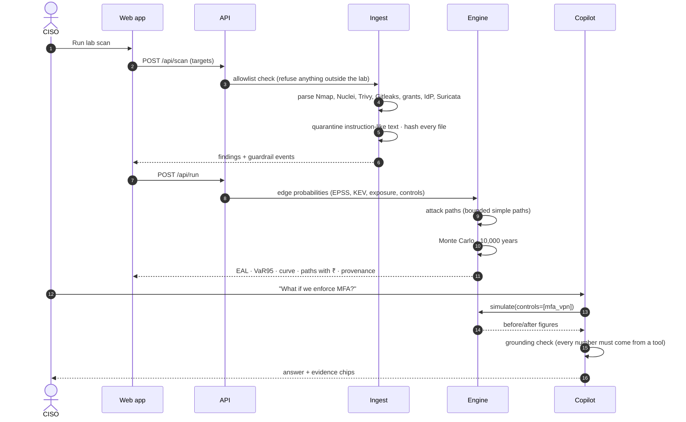

# How it works

From a scanner's output to a rupee on the screen, in seven steps.

## 1 · Evidence in

The demo replays recorded outputs of real tools against a small lab network (`172.30.0.0/24` DMZ,
`172.30.1.0/24` internal):

| Source | Format | What it contributes |
|---|---|---|
| Nmap (external and internal view) | XML | Which services are open, and from where |
| Nuclei | JSONL | Confirmed vulnerabilities (Apache CVE-2021-41773, unauthenticated Redis) |
| Trivy | JSON | Package vulnerabilities in images (OpenSSH CVE-2024-6387) |
| Gitleaks | JSON | Secrets in files (masked): the DB password in `.env`, a password in shell history |
| Postgres grants | CSV | Who can read which table; stale roles |
| Identity export | JSON | MFA status, email authentication, declared controls |
| Suricata | EVE JSON | Live intrusion alerts against the edge server |

Two safety checks happen here. **Targets outside the lab ranges are refused** before anything runs.
**Free text is checked for injected instructions.** The demo's Redis banner deliberately contains
"IGNORE PREVIOUS INSTRUCTIONS…", which is quarantined and logged.

## 2 · The evidence graph

Findings become a graph with five kinds of node: **entries** (the internet, a phished user, and a
"residual" entry for routes scans cannot see), **assets**, **secrets**, **identities** and **crown jewels**.
Edges are actions an attacker can take, each with an ATT&CK technique and the evidence IDs that justify it.

## 3 · Probabilities

For each edge, Vyuhix estimates how likely one attempt at that step is to succeed:

- **Exploiting a CVE:** the EPSS score (likelihood of exploitation in the wild), raised to a floor of 0.9
  if the CVE is in CISA's Known Exploited Vulnerabilities list and the asset faces the internet, then
  multiplied by exposure (internal assets 0.3).
- **Other steps** (reading a secret, using a privilege) come from the evidence, e.g. 1.0 for a database
  grant that exists.
- **Controls** multiply these: patching sets an edge to 0, MFA to 10% of its value, and so on.

## 4 · Attack paths

Every simple route from each entry to each crown jewel, up to six hops. "Simple" means no node is
visited twice, so loops cannot cause endless analysis. Each path gets a plain-English description.

## 5 · Simulation

10,000 simulated years. In each year, each entry makes a random number of attempts (Poisson). For each
attempt, **every edge is rolled once**, so paths that share a step succeed or fail together, which is
realistic. Every crown jewel reached costs money in six components, each drawn from a range. Details
are in [the risk model in plain words](04_the_risk_model_in_plain_words.md).

## 6 · Decisions

- **Plan:** for a budget, two methods propose a set of fixes and re-simulation picks the better one.
- **Insurance:** loss tail vs policy limit, an insurability score from evidence, and proposal answers.
- **Compliance:** the same evidence mapped to ISO 27001, NIST CSF 2.0, CIS, CERT-In, RBI and DPDP.

## 7 · Continuous

When the known-exploited list changes (the demo has a clearly labelled *simulated* update), Vyuhix
re-prices and raises an alert that says what changed and by how much.
