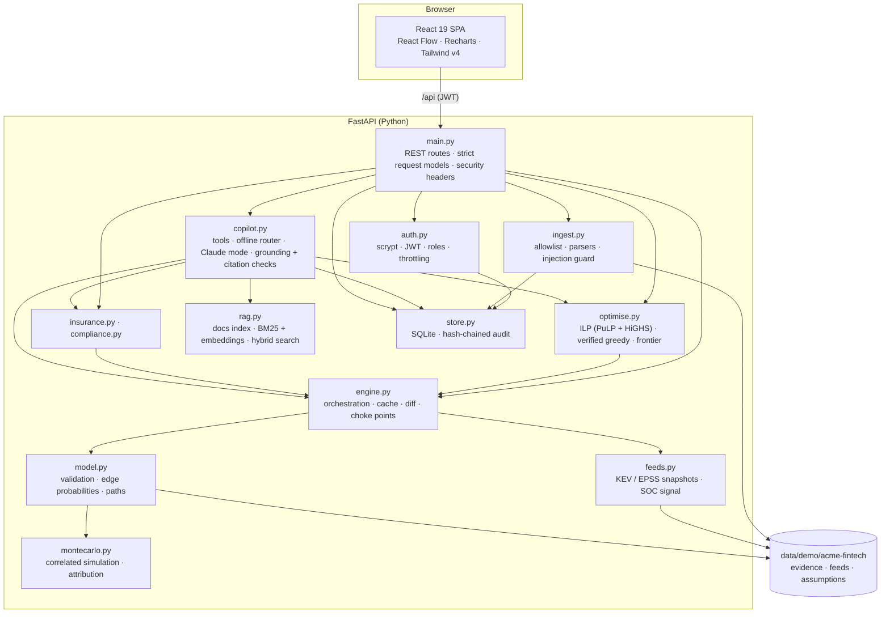

# Architecture

## Components

## Design decisions

| Decision | Why |
|---|---|
| **Deterministic engine; AI at the edges** | Underwriters, auditors and regulators need reproducible numbers. The AI explains; it cannot change a figure |
| **Sample edges, not paths** | Paths that share a step must fail together. Sampling paths independently would overstate risk |
| **Common random numbers** | Random draws do not depend on which controls are on, so "before vs after" differences are exact rather than noise |
| **A residual entry** | Scans never see everything. Modelling the unseen keeps the optimiser from claiming zero risk |
| **ILP and greedy, verified by simulation** | The fast linear surrogate can over-credit overlapping controls. Re-simulation is the judge, and the frontier is forced to be monotone |
| **LRU cache keyed by an input hash** | Toggling a control back is instant; the same hash always gives the same answer |
| **Strict request models** (`extra="forbid"`) | Unknown fields are rejected, not ignored |
| **SQLite with an append-only audit log** | No infrastructure to install. Triggers block UPDATE and DELETE; a hash chain detects tampering anyway |
| **Built SPA served by the API** | One process, one port, works offline |

## Data model (level 1)

| Store | Content |
|---|---|
| `data/demo/<org>/*.json` | Organisation, graph, controls, assumptions (versioned in git) |
| `data/demo/<org>/evidence/` | Tool outputs (synthetic, real formats) |
| `data/demo/<org>/feeds/` | KEV and EPSS snapshots, plus the labelled simulated update |
| `data/runtime/vyuhix.db` | users · audit_log · guardrail_events · jobs · alerts · copilot_calls · state |

## Performance

A 10,000-year run of the demo graph takes about 10 ms. A budget plan with re-simulation takes 0.1–0.4 s.
The frontier takes about 0.4 s. All runs are cached by input hash.

## Level 2 architecture

Level 2 adds a live Docker lab, Supabase (Auth with TOTP MFA, Postgres with row-level security, Storage),
OpenTelemetry with Grafana, and a job worker. See [the roadmap](10_roadmap.md).
